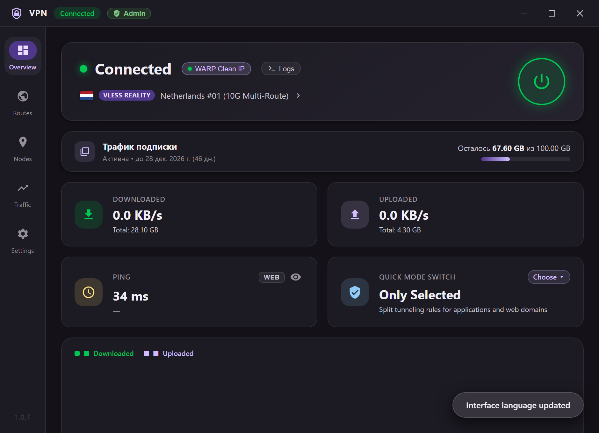
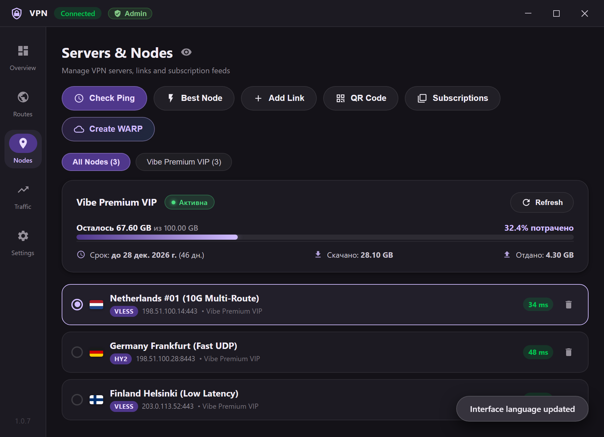
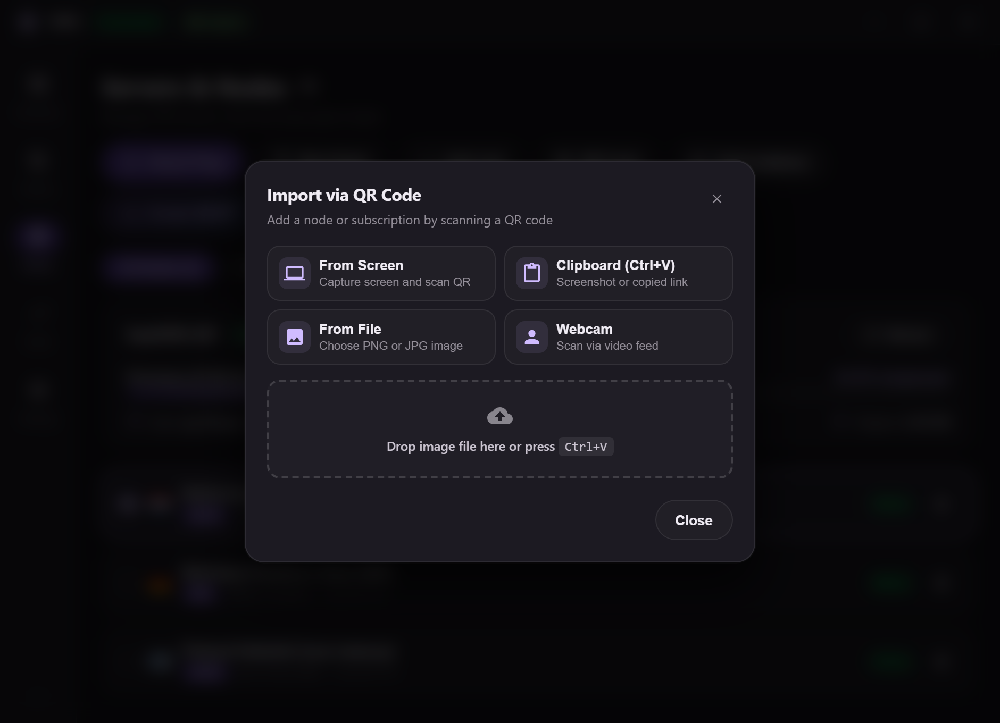
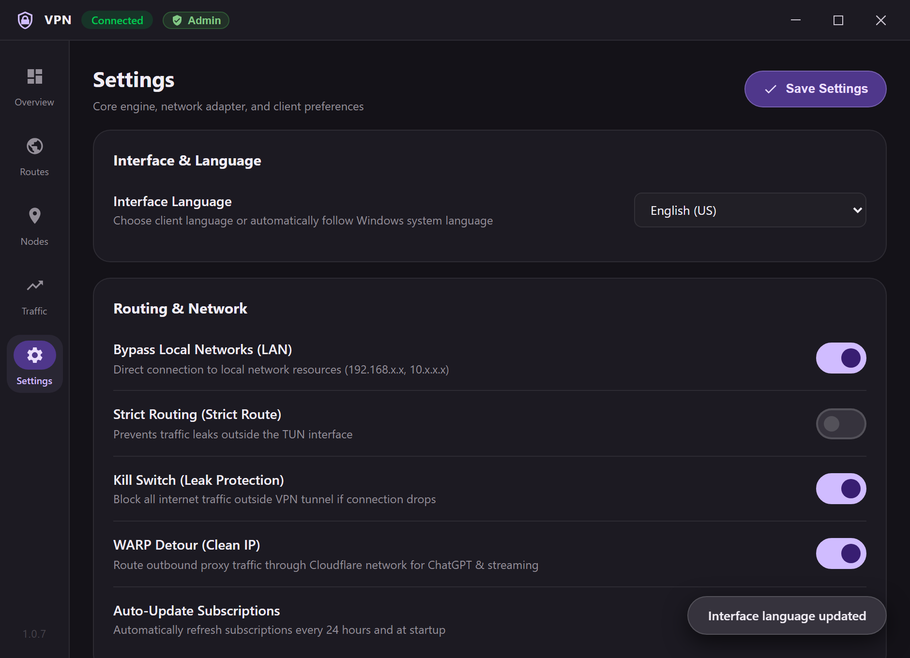

# VibeVPN — Fast & Simple Windows VPN Client

<div align="center">

<p align="center">
  <a href="README.md">🇷🇺 Русский</a> | <b>🇬🇧 English</b>
</p>


**A fast and lightweight Windows VPN client with per-application Split Tunneling, Cloudflare WARP (AmneziaWG / MASQUE), QR code import, and real-time process monitoring.**

[Download Latest Release](https://github.com/zalupacode228/vibe-vpn/releases) • [Features](#-key-features) • [Building from Source](#-building-from-source)

</div>

---

## 📸 Screenshots

<div align="center">

| **Dashboard (Dark Glassmorphism)** | **Servers & Nodes (Categorized)** |
|:---:|:---:|
|  |  |

| **QR-Code Multi-Import** | **Settings & Localization (RU / EN)** |
|:---:|:---:|
|  |  |

</div>

---

## ✨ Key Features

- **⚡ Per-Application Split Tunneling**:
  - Full control over which `.exe` applications route through VPN vs direct connection.
  - Supports both **Whitelist** (proxy only selected apps) and **Blacklist** (proxy all except selected apps).
  - Automatically lists running Windows processes with real-time process icons and names.
  - Ability to pick any `.exe` file via file picker.

- **🛡️ Built-in Cloudflare WARP Generator**:
  - **AmneziaWG (awg)**: DPI bypass using randomized junk packets (`jc`, `jmin`, `jmax`, `h1`–`h4`) to defeat active Russian DPI blocks.
  - **MASQUE / HTTP/3**: Web traffic disguise over QUIC UDP port 443.
  - Generates working Cloudflare client keys on the fly with automatic WireGuard peer configuration.

- **📷 Universal QR-Code Importer**:
  - **From Screen**: One-click screen capture with automatic QR code scanning.
  - **From Clipboard (`Ctrl+V`)**: Instant detection of copied QR screenshot images or raw config text.
  - **From File**: Drag-and-drop or file picker for PNG, JPG, WebP.
  - **Live Webcam Feed**: Scan QR codes directly with your camera.
  - Automatically recognizes single nodes, bulk node lists, or subscription links.

- **🌐 Smart Routing & Custom Geo-Rules**:
  - Built-in **Bypass RU** (auto-routes blocked services like YouTube, Discord, Twitter, Instagram).
  - Built-in **AdBlock** (DNS-level ad and tracker blocking).
  - Support for **AntiZapret** lists, custom GitHub raw lists (`.txt` / `.json`), and custom domain rules.

- **🚀 Comprehensive Protocol Support**:
  - VLESS (Reality, TLS, WebSocket, gRPC)
  - VMess
  - Shadowsocks (2022)
  - Trojan
  - Hysteria 2 / Hy2
  - TUIC v5
  - WireGuard & AmneziaWG (AWG)

- **📊 Live Telemetry & Process Tree**:
  - Real-time 60 FPS bandwidth speed graph (Download / Upload).
  - High-precision ping latency test with visual color indicators (green / yellow / red).
  - Interactive **Connection Tree** grouped by active Windows process names, displaying exact destination IPs, routing rules, and bandwidth.

- **🌍 Bilingual Localization & System Auto-Detection**:
  - Automatically detects Windows system language at startup (Russian for RU/CIS systems, English for rest of world).
  - Instant on-the-fly language switching in Settings without restarting the application.

- **🎨 Industrial Design & Privacy**:
  - Material 3 Dark Glassmorphism interface.
  - Responsive layout (desktop navigation rail + adaptive mobile/compact bottom navigation).
  - **Privacy Blur Mode**: One-click blur of IP addresses, server domains, and private keys for safe livestreaming and screenshots.
  - Minimization to system tray with quick-actions menu.

---

## 🚀 Download & Installation

1. Go to the [Releases](https://github.com/zalupacode228/vibe-vpn/releases) page.
2. Download the latest `VibeVPN-Windows-x64.exe`.
3. Run the executable.
   > **Note**: Requires Windows 10 or 11 (64-bit). Administrator privileges are required to create the TUN network adapter (`wintun.dll`).

---

## 🛠️ Building from Source

### Prerequisites
- **Go**: `1.22+` or `1.23+` ([golang.org](https://go.dev/dl/))
- **Node.js**: `18+` or `20+` ([nodejs.org](https://nodejs.org/))
- **Wails CLI v2**:
  ```powershell
  go install github.com/wailsapp/wails/v2/cmd/wails@latest
  ```
- **WebView2 Runtime** (installed by default on Windows 10/11)

### Development Mode
To run with live hot-reloading for frontend and Go backend:
```powershell
# Clone the repository
git clone https://github.com/zalupacode228/vibe-vpn.git
cd vibe-vpn

# Run in live development mode
wails dev
```

### Production Build
To create a standalone, monolithic single-file binary:
```powershell
wails build
```
The compiled executable will be located at:
```
build/bin/VPN.exe
```

---

## 🏗️ Architecture

```
vibe-go/
├── app.go                 # Wails Go application controller & Windows API bindings
├── main.go                # Application entrypoint & Wails configuration
├── assets/
│   ├── core/              # Embedded monolithic core (sing-box.exe + wintun.dll)
│   └── screenshots/       # UI showcase images
├── pkg/
│   ├── models/            # Core data types (Nodes, Settings, Rules, Subscriptions)
│   ├── singbox/           # Sing-box JSON generator & process controller
│   ├── procmon/           # Windows active processes & exe icon extractor
│   ├── storage/           # Local state storage in %APPDATA%\VPN
│   ├── subs/              # Subscription parser & base64/clash decoder
│   ├── pinger/            # Concurrent TCP/ICMP ping engine
│   ├── warp/              # Cloudflare WARP registration (AWG & MASQUE)
│   └── tray/              # Native Windows system tray integration
└── frontend/              # Ultra-fast Vanilla JS + Vite frontend
    ├── src/
    │   ├── main.js        # UI orchestration & state management
    │   ├── i18n.js        # Bilingual dictionary & auto-detection
    │   └── style.css      # Material 3 Dark Glassmorphism styles
    └── index.html         # Application single-page DOM
```

---

## 🤝 Contributing

Contributions, bug reports, and feature requests are welcome!
Feel free to open an issue or submit a pull request.

1. Fork the Project
2. Create your Feature Branch (`git checkout -b feature/AmazingFeature`)
3. Commit your Changes (`git commit -m 'Add some AmazingFeature'`)
4. Push to the Branch (`git push origin feature/AmazingFeature`)
5. Open a Pull Request

---

## 📄 License

Distributed under the **MIT License**. See [`LICENSE`](LICENSE) for more information.

---

<div align="center">
Made with ❤️ using Go, Wails v2, and sing-box.
</div>
